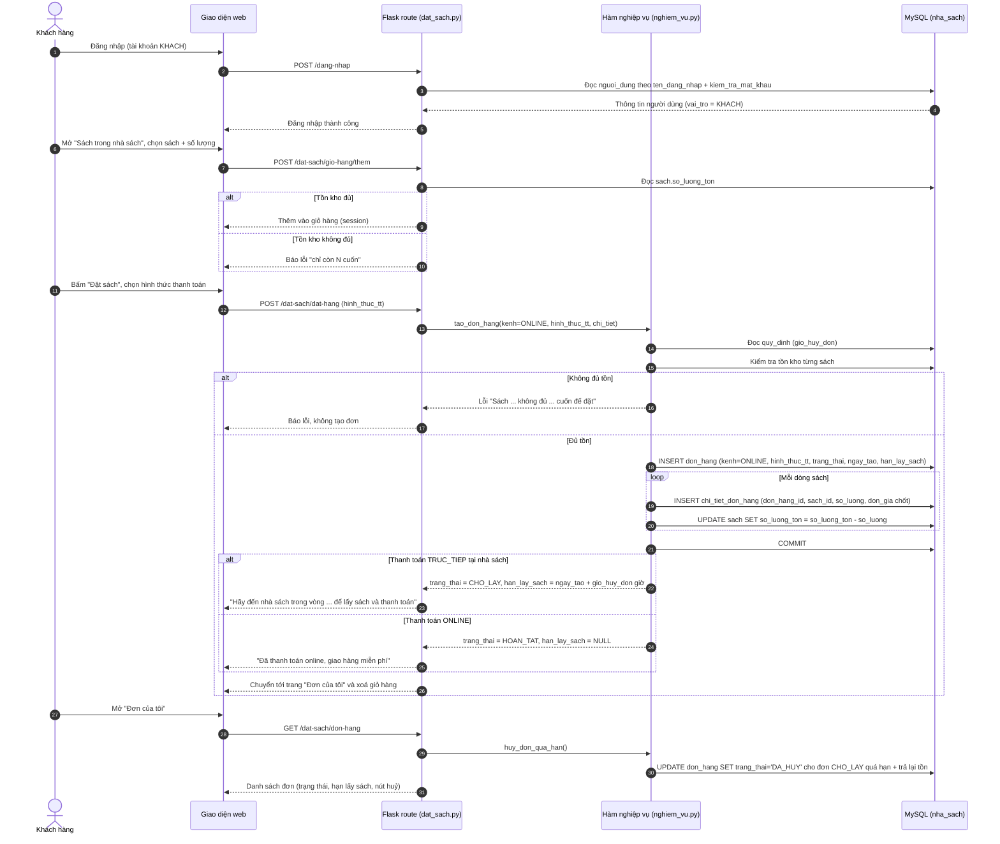
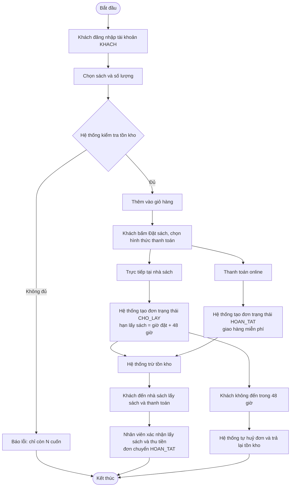

# UC02 – Đặt sách online (Khách hàng) – Sơ đồ tuần tự & hoạt động

> Vẽ bằng Mermaid: dán khối `mermaid` vào <https://mermaid.live> rồi xuất ảnh PNG cho báo cáo
> (Chương 2 – mục 2.2 và 2.3). Nhớ đánh số hình theo thứ tự (Hình 2.x).

## Sơ đồ tuần tự

## Sơ đồ hoạt động

## Làn (swimlane) theo vai trò

| Làn (vai trò) | Các bước trong làn |
| --- | --- |
| **Khách hàng** | Đăng nhập → chọn sách, số lượng → thêm vào giỏ → bấm "Đặt sách" → chọn hình thức thanh toán → xem "Đơn của tôi" → (nếu còn trong hạn) huỷ đơn |
| **Hệ thống (Flask + MySQL)** | Kiểm tra tồn → ghi `don_hang` + `chi_tiet_don_hang` → trừ tồn → tính `han_lay_sach` → tự huỷ đơn quá hạn và trả lại tồn |
| **CSDL MySQL** | Lưu đơn/chi tiết; cập nhật `sach.so_luong_ton` |
| **Nhân viên bán hàng** | Nhận khách lấy sách → xác nhận và thu tiền (UC04) |
