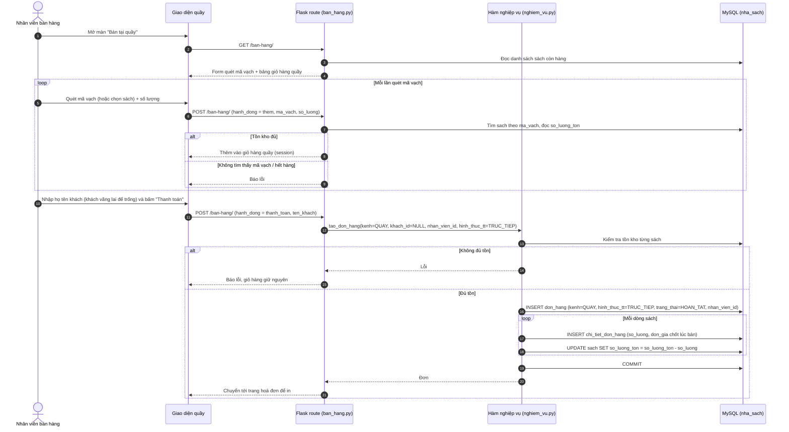
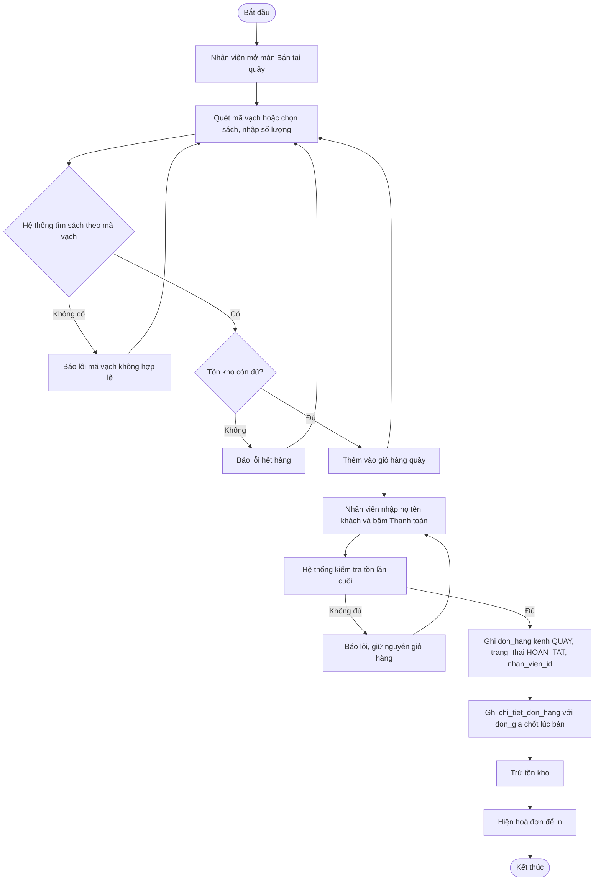

# UC03 – Bán sách tại quầy (Nhân viên bán hàng) – Sơ đồ tuần tự & hoạt động

> Vẽ bằng Mermaid: <https://mermaid.live>.

## Sơ đồ tuần tự

## Sơ đồ hoạt động

## Làn (swimlane) theo vai trò

| Làn (vai trò) | Các bước trong làn |
| --- | --- |
| **Nhân viên bán hàng** | Mở màn bán hàng → quét mã vạch từng cuốn → sửa/xoá giỏ quầy → nhập họ tên khách → bấm "Thanh toán" → in hoá đơn |
| **Hệ thống (Flask + MySQL)** | Tìm sách theo `ma_vach` → kiểm tra tồn → ghi `don_hang` (`kenh='QUAY'`, `trang_thai='HOAN_TAT'`, `nhan_vien_id`) + `chi_tiet_don_hang` → trừ `sach.so_luong_ton` |
| **CSDL MySQL** | Lưu hoá đơn và chi tiết, cập nhật tồn kho |
