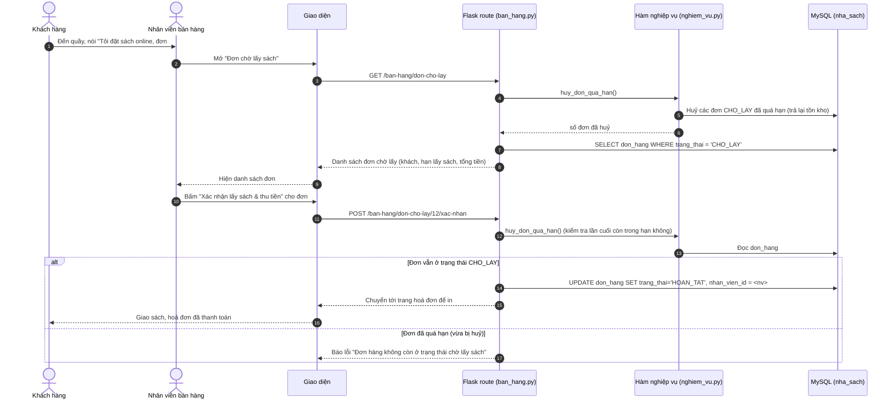
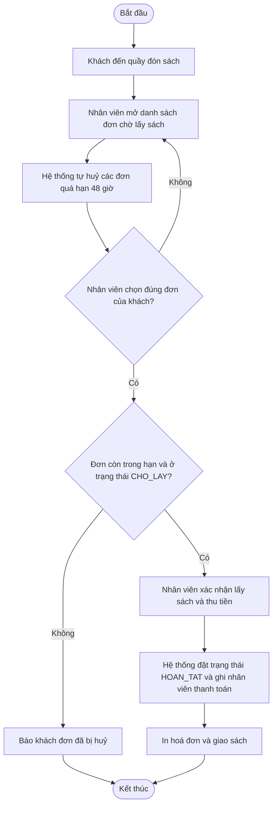

# UC04 – Xác nhận khách lấy sách và thu tiền (Nhân viên bán hàng)

> Use case nhỏ, không đặc tả riêng – được gộp vào luồng 4b của UC02 (đề xuất đã chốt ở
> `PROJECT_CONTEXT.md` mục 3.11). Vẽ bằng Mermaid: <https://mermaid.live>.

## Sơ đồ tuần tự

## Sơ đồ hoạt động

## Làn (swimlane) theo vai trò

| Làn (vai trò) | Các bước trong làn |
| --- | --- |
| **Khách hàng** | Đến quầy đón sách → nhận sách và hoá đơn |
| **Nhân viên bán hàng** | Mở danh sách đơn chờ lấy → tìm đơn của khách → bấm "Xác nhận lấy sách & thu tiền" → thu tiền và giao sách |
| **Hệ thống (Flask + MySQL)** | Tự huỷ đơn quá hạn → kiểm tra trạng thái đơn → `UPDATE don_hang SET trang_thai='HOAN_TAT', nhan_vien_id=...` |
| **CSDL MySQL** | Cập nhật trạng thái đơn và nhân viên thanh toán |
