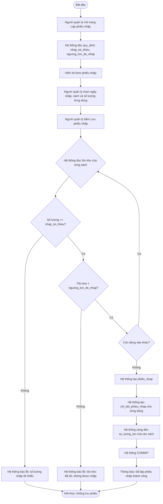

# UC05 – Lập phiếu nhập sách – Sơ đồ hoạt động (Activity Diagram)

> Vẽ bằng Mermaid: <https://mermaid.live>. Đưa vào báo cáo Chương 2 – mục 2.2 Sơ đồ hoạt động.

## Làn (swimlane) theo vai trò – dùng khi vẽ bằng draw.io / StarUML

| Làn (vai trò) | Các bước trong làn |
| --- | --- |
| **Người quản lý (kho)** | Mở trang phiếu nhập → chọn ngày nhập → chọn sách + số lượng từng dòng → bấm "Lưu phiếu nhập" → (nếu lỗi) đọc thông báo và sửa lại → nhận thông báo thành công |
| **Hệ thống (Flask + MySQL)** | Đọc `quy_dinh` → kiểm tra từng dòng theo luật 150/300 → tạo `phieu_nhap` → tạo `chi_tiet_phieu_nhap` → cộng `sach.so_luong_ton` → COMMIT (hoặc báo lỗi) |
| **CSDL MySQL** | Lưu `phieu_nhap`, `chi_tiet_phieu_nhap`; cập nhật `sach.so_luong_ton` |

