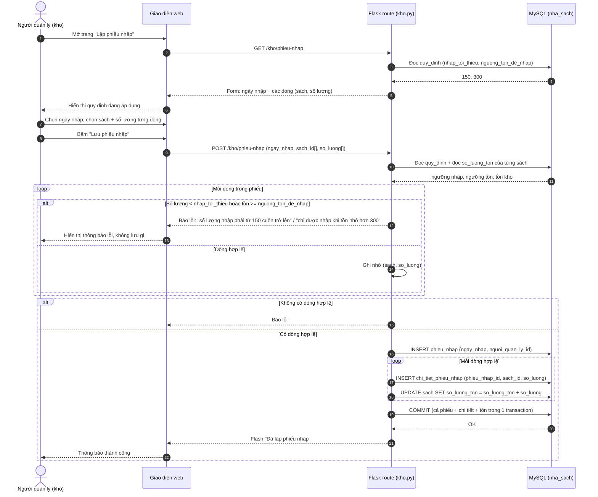

# UC05 – Lập phiếu nhập sách – Sơ đồ tuần tự (Sequence Diagram)

> Vẽ bằng Mermaid: dán nội dung khối `mermaid` vào <https://mermaid.live> rồi xuất ảnh PNG
> để đưa vào báo cáo (Chương 2 – mục 2.3 Sơ đồ tuần tự).

