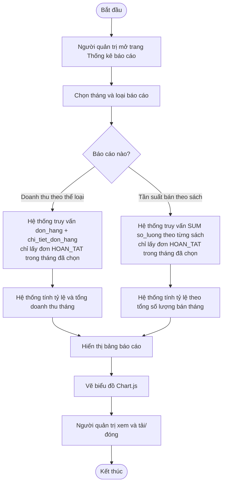

# UC07 – Xem thống kê báo cáo – Sơ đồ hoạt động (Activity Diagram)

> Vẽ bằng Mermaid: <https://mermaid.live>. Đưa vào báo cáo Chương 2 – mục 2.2.

## Làn (swimlane) theo vai trò

| Làn (vai trò) | Các bước trong làn |
| --- | --- |
| **Người quản trị** | Mở trang Thống kê → chọn tháng → chọn loại báo cáo → xem bảng + biểu đồ |
| **Hệ thống (Flask + MySQL)** | Nhận tham số tháng → truy vấn CSDL → tính tỷ lệ, tổng → trả bảng + dữ liệu biểu đồ |
| **CSDL MySQL** | Cung cấp `don_hang`, `chi_tiet_don_hang`, `sach`, `the_loai` để tổng hợp |
