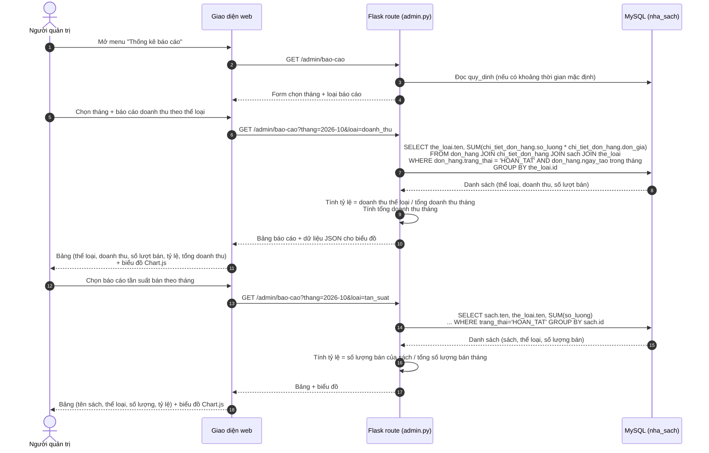

# UC07 – Xem thống kê báo cáo – Sơ đồ tuần tự (Sequence Diagram)

> Vẽ bằng Mermaid: <https://mermaid.live>. Đưa vào báo cáo Chương 2 – mục 2.3.
> Lưu ý: phần này A sẽ code ở **tuần 3**; sơ đồ được vẽ trước theo kế hoạch tuần 2.

## Quy ước đã chốt cho báo cáo (dùng chung với B)

| Quy ước | Nội dung |
| --- | --- |
| Chỉ tính đơn | `don_hang.trang_thai = 'HOAN_TAT'` (đơn `CHO_LAY` và `DA_HUY` không tính) |
| Mốc tháng | Theo `don_hang.ngay_tao` |
| Giá dùng để tính | `chi_tiet_don_hang.don_gia` (giá đã chốt lúc bán), **không** lấy `sach.don_gia` |
| Tổng tiền | Không lưu trong CSDL, tính bằng `SUM(so_luong * don_gia)` |
| Cột "số lượt thuê" trong mẫu | Hiểu là **"số lượt bán"** = tổng số cuốn đã bán của thể loại trong tháng (giả định đã ghi ở Chương 1) |
| Tỷ lệ báo cáo 1 | doanh thu thể loại / tổng doanh thu tháng |
| Tỷ lệ báo cáo 2 | số lượng bán của sách / tổng số lượng bán trong tháng |
